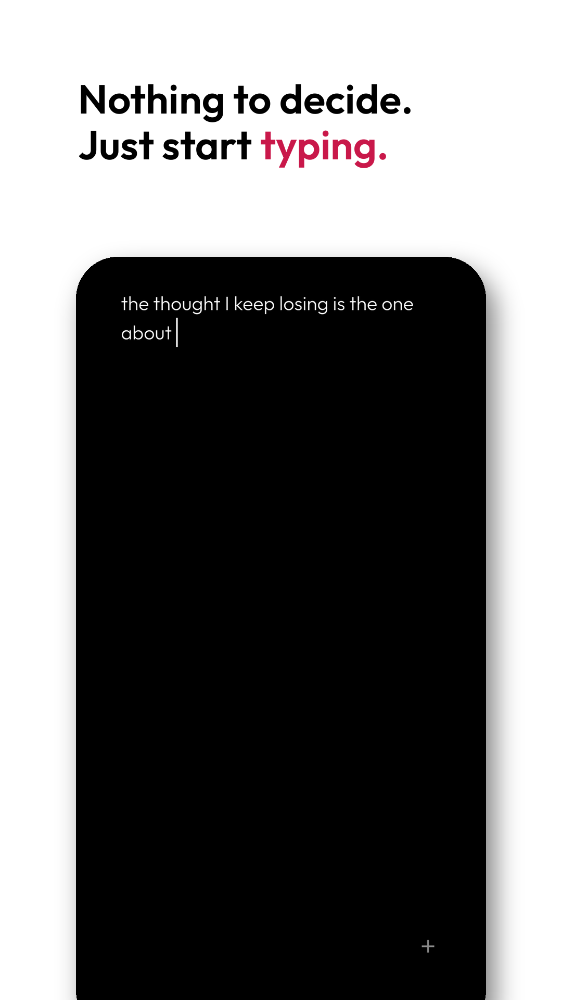
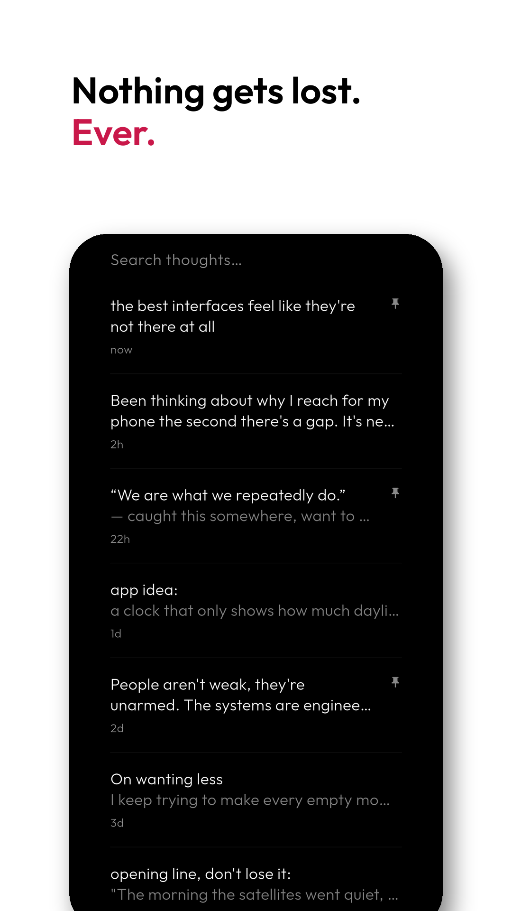
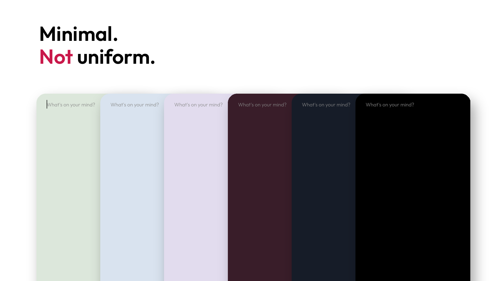
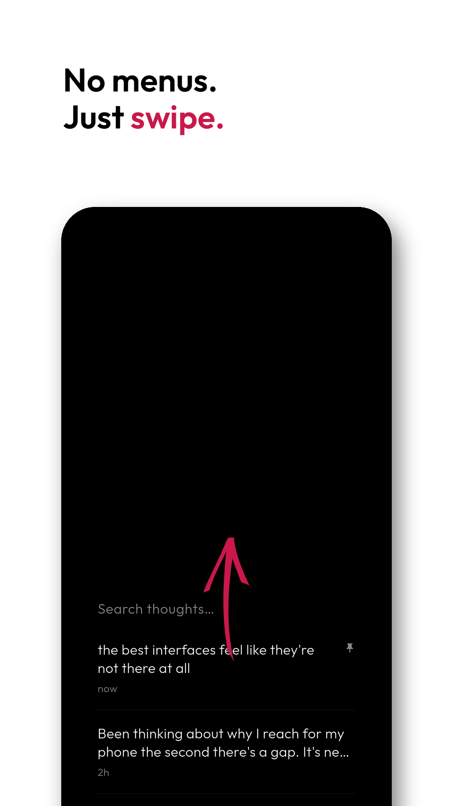

# Mars Thoughts

[](https://play.google.com/store/apps/details?id=com.catchingclouds.marsthoughts)

A place for thoughts to land before they disappear. Open the app and the cursor is already there. No titles, no folders, no save button.

I kept losing thoughts because every notes app wanted a decision before I'd finished typing.

<p>
  
  
  
  
  
  
</p>

## What it does

- Opens straight into a blank page. Leave, and it's still there when you come back.
- Tap the plus to file a thought away and start a new one.
- Swipe up for everything you've written, down for pinned thoughts, further down for settings.
- Hold a thought to select it, then pin, copy or delete.
- Swipe a thought left to delete (it goes to the trash), right to copy. Search finds anything.
- Double tap switches between dark and light.
- Offline and private. No ads, no tracking, no account.

## Build

You need the [Flutter SDK](https://docs.flutter.dev/get-started/install).

```bash
./install_debug.sh      # installs as "Mars Thoughts Debug"
./install_release.sh    # installs as "Mars Thoughts"
```

## Under the hood

Flutter and Dart, GetIt for DI, `ValueNotifier` for state, SharedPreferences for storage. A separate private build flavor adds encrypted sync to my own server; it is compiled out of the public app. See [CLAUDE.md](CLAUDE.md).

Part of [Mars](https://github.com/libaum/mars), a family of small, calm apps.

## License

MIT
